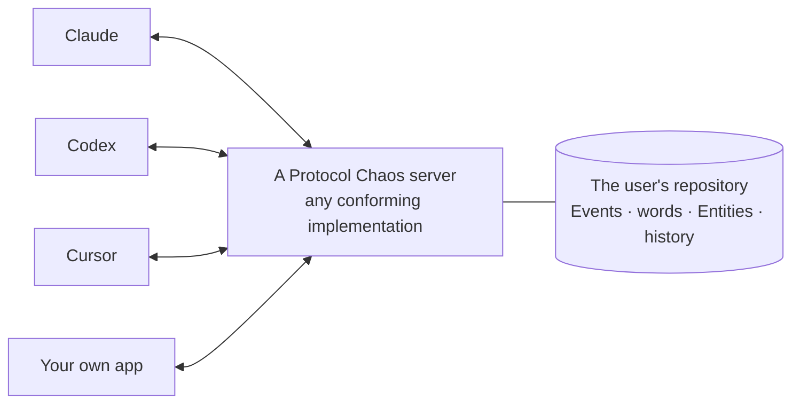

# Protocol Chaos

[](https://www.npmjs.com/package/protocol-chaos)
[](PROTOCOL.md)
[](https://github.com/chaos-xxl/protocol-chaos/actions/workflows/test.yml)
[](LICENSE)

English · [简体中文](docs/README.zh-CN.md)

**An open protocol for the matters in a person's life, held by the person and shared by every AI assistant they use.**

People tell their AI assistants about trips, renovations, job searches, purchases and ambitions. Each assistant keeps what it hears to itself, so the same plan is explained again to every new assistant and is lost when the tool changes. Protocol Chaos keeps these matters in one repository that belongs to the user. Any compatible assistant can read it, add to it and connect what it holds, and the matters outlast any one assistant.

With Protocol Chaos, an assistant can:

- **Pick up where another left off**: read what the user told a different assistant, on a different computer, weeks ago.
- **Keep the user's words**: record them verbatim, and mark its own inferences as inferences.
- **Connect matters**: place a trip under the wish it serves, and point it at the people it involves.
- **Write alongside other assistants**: without overwriting what another has committed, with every change recorded.



## Quick start

You need Node.js 20 or later and an assistant that can use MCP servers. Add the reference server under the name `protocol_chaos`:

- **Claude Code:**

  ```sh
  claude mcp add --scope user protocol_chaos -- npx -y protocol-chaos@0.2
  ```

- **Codex**, in `~/.codex/config.toml`:

  ```toml
  [mcp_servers.protocol_chaos]
  command = "npx"
  args = ["-y", "protocol-chaos@0.2"]
  ```

- **Claude Desktop, Cursor, Kiro** and other clients configured in JSON (`claude_desktop_config.json`, `~/.cursor/mcp.json`, `~/.kiro/settings/mcp.json`):

  ```json
  { "mcpServers": { "protocol_chaos": { "command": "npx", "args": ["-y", "protocol-chaos@0.2"] } } }
  ```

Then tell one assistant about something you are planning, for example "I'd like to get into street photography, but only at weekends". Ask another assistant, or a new conversation, what you said about photography. The matter is stored in `~/.protocol-chaos/repository.json`, a plain file that belongs to you.

For the best results, give each assistant the [standing instructions](docs/agent-guide.md#server-instructions): MCP tells an assistant which tools exist, not when to use them. `protocol-chaos@0.2` follows this draft and its fixes; a later draft will be `0.3`.

## Why Protocol Chaos?

- **The user holds the matters.** The repository belongs to the user, not to an assistant or a vendor, and every conforming server can export it whole and import it elsewhere.
- **Matters are connected.** What looks like a one-off rarely is: a trip belongs to a wish to see more of the world, a camera serves a hobby. Parents, and the people and places Events share, make those connections explicit.
- **Words are evidence.** The user's words are kept verbatim and never edited. Everything an assistant concludes rests on them, and the user's words win.
- **Sparse is normal.** A matter can be one sentence. Assistants record what was said instead of questioning the user to complete it.
- **Small and testable.** The specification defines only what implementations must agree on, and every requirement on servers has a conformance test.
- **Built on MCP.** Every operation is an MCP tool, so any MCP client can use a conforming server, written in any language.

## What the protocol defines

| | |
|---|---|
| **Events** | A matter: its title, state and progress; its goal, constraint and plan, in natural language; the people, places and things it involves; and the larger Events it is part of. |
| **Accounts** | The user's words an Event rests on, kept verbatim and never edited. |
| **Entities** | The people, animals, things and places the user refers to, the user included, each described by one-fact Statements. |
| **Revisions** | Every change, naming who made it and the words it rests on. |
| **Writer rules** | What to record and what not to, so that every assistant writing to the same repository behaves the same way. |
| **Levels** | Core, and the optional levels Entities, Search, Sync, Undo and Remote. |

How a client finds the Events a conversation is about, how it ranks them and when it tidies up are left to the client. The full rules are in **[PROTOCOL.md](PROTOCOL.md)**.

## Repository contents

| Path | |
|---|---|
| [PROTOCOL.md](PROTOCOL.md) | The specification. Normative. |
| [conformance/](conformance/README.md) | Conformance tests that check any server over MCP. |
| [server/](server/README.md) | The reference server: Core, Entities, Search, Sync and Undo, on one computer. |
| [docs/agent-guide.md](docs/agent-guide.md) | How an assistant can use a repository well: answer first, record after, organise later. Not normative. |

## Implementing the protocol

1. Read [PROTOCOL.md](PROTOCOL.md) and start with the Core level (§12).
2. Offer the operations as MCP tools (§9.1): over stdio on one computer, or over streamable HTTP, with a credential for each client, when several computers share a repository (§9.2).
3. Test your server, whatever its language, with no need to clone anything:

   ```sh
   npx -y -p protocol-chaos@0.2 protocol-chaos-conformance --stdio "node my-server.js --data {tmp}"
   ```

   `{tmp}` becomes a fresh, empty directory for each server the suite starts. The tests write data, so they refuse to run against a repository that is not empty.

The specification is meant to be enough on its own. To check that, an agent that had never seen any implementation wrote a server from the document alone. Its first run passed 39 of the 40 Core tests of the time, and the one gap it found was fixed in the document. That server became the reference server here.

## Your data

- The repository belongs to its user, and can always be exported and moved to another server (§8.6).
- The reference server keeps it in one file on your computer and sends it nowhere.
- Every connected assistant can currently read the whole repository; per-client visibility is not designed yet (§13). Connect only assistants you would trust with all of it. What an assistant reads enters its model context and is processed by its provider.
- Assistants are told never to record passwords, tokens or identity-document numbers (§7).

## Status and roadmap

Protocol Chaos is a draft, and drafts carry no compatibility promise. Draft 0.2 grew out of daily use: its author has used an implementation of draft 0.1 every day, with several assistants on different computers sharing one repository, and draft 0.2 keeps what that use showed to matter. That implementation is not part of this repository, and is moving to draft 0.2.

Next:

- The Remote binding (§9.2) in the reference server, so that several computers and cloud assistants can share one repository.
- Per-client visibility: what each assistant may read (§13).
- Recognising the same person across applications (§13).
- Draft 0.3, from the cases people report.

The [changelog](CHANGELOG.md) lists every release.

## FAQ

**Is this a memory product?** No, it is a protocol: an agreement on how a person's matters are kept, so that any assistant can use them. An assistant's own memory stays with that assistant; Protocol Chaos keeps the matters for the person, across assistants.

**Do I need a server?** Yes, any conforming one. The reference server runs on your computer with one command. You can also write your own, and the conformance tests tell you when it is right.

**Which assistants work with it?** Any MCP client that can start a local server. The quick start covers Claude Code, Codex, Claude Desktop, Cursor and Kiro. Cloud assistants need a server that implements the Remote level.

**Where is my data?** Where your server runs, and nowhere else. See [Your data](#your-data).

## Contributing

What the protocol needs most is evidence from real use: cases where it fits, cases where it falls short, and implementations.

- **Questions and ideas:** [Discussions](https://github.com/chaos-xxl/protocol-chaos/discussions)
- **Changes to the specification:** a [proposal](https://github.com/chaos-xxl/protocol-chaos/issues/new?template=spec_proposal.yml) that starts from a real case
- **Bugs:** [issues](https://github.com/chaos-xxl/protocol-chaos/issues)
- **Security problems:** privately, as [SECURITY.md](SECURITY.md) describes

See [CONTRIBUTING.md](CONTRIBUTING.md) for how changes are decided.

## About

Protocol Chaos was created by Xue Xinglong ([@chaos-xxl](https://github.com/chaos-xxl)), and is part of the Chaos family, alongside Doctor Chaos. It is licensed under the [Apache License 2.0](LICENSE).
