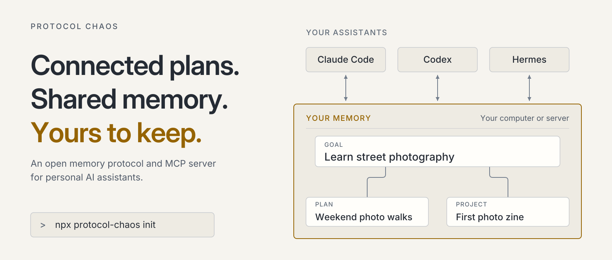

<picture>
  <source media="(max-width: 600px) and (prefers-color-scheme: dark)" srcset="https://raw.githubusercontent.com/chaos-xxl/protocol-chaos/main/docs/assets/hero-dark-compact.svg?v=2">
  <source media="(max-width: 600px)" srcset="https://raw.githubusercontent.com/chaos-xxl/protocol-chaos/main/docs/assets/hero-light-compact.svg?v=2">
  <source media="(prefers-color-scheme: dark)" srcset="https://raw.githubusercontent.com/chaos-xxl/protocol-chaos/main/docs/assets/hero-dark.svg?v=2">
  
</picture>

[](https://www.npmjs.com/package/protocol-chaos)
[](PROTOCOL.md)
[](https://github.com/chaos-xxl/protocol-chaos/actions/workflows/test.yml)
[](LICENSE)

English · [简体中文](docs/README.zh-CN.md)

**Connected plans. Shared memory. Yours to keep.**

An open memory protocol and MCP server for personal AI assistants.

Protocol Chaos keeps the things you are working toward—projects, trips, learning goals—as connected records: what each is for, where it stands, and how it fits into the bigger picture.

- **See how your plans fit together.** Keep a goal, its parts and their progress connected. Your assistant can follow an ongoing matter across conversations, and your app can use the same structure to build a coherent view of it.
- **Pick up with another assistant.** Compatible assistants read and update the same matters, including the latest constraints and plans. Changes keep their author and source words.
- **Keep your memory when tools change.** The repository is on your own computer or server. What you have saved there stays under your control if an assistant account becomes unavailable, and can move to another conforming implementation.

Useful with one assistant across new conversations, several assistants sharing context, or a personal agent you are building.

[Try it](#quick-start) · [Build a personal agent](#for-personal-agent-builders) · [Read the protocol](PROTOCOL.md)

## Quick start

Requires **Node.js 20+** on **macOS or Linux**.

~~~sh
npx protocol-chaos init
~~~

1. **Choose your assistants.** The installer finds the ones on your computer and connects those you select to one repository.
2. **Tell one about an ongoing plan.** For example: “I'd like to get into street photography, but only at weekends.”
3. **Continue in a new conversation.** Ask what you said about photography, in the same assistant or another connected one. Later, change a constraint and check that the next conversation reads the new plan.

The installer can also import your assistants' existing memory files. It shows what it would read, where the text goes, and the estimated model usage before asking. The original files are only read. [How importing works](server/README.md#importing-other-assistants-memories).

Setup adapters cover **Claude Code, Codex, DeepSeek Harness, Hermes, Kiro, Cursor, OpenCode, OpenClaw, Claude Desktop, GitHub Copilot and Pi**. Real-session validation across these adapters is still in progress; see [setup details](server/README.md#installer).

The installer can select a connected assistant to organize newly recorded words in the background. If none is available, your assistant is prompted to update the matter in the conversation. Hermes uses its own plugin. [How organizing works](server/README.md#organizing-in-the-background).

Use <code>npx protocol-chaos doctor</code> to check connections and <code>npx protocol-chaos uninstall</code> to undo setup. The repository is kept. [Your data](#your-data).

<details>
<summary>Manual MCP setup and multiple computers</summary>

To connect an assistant by hand instead, add the reference server under the name `protocol_chaos`:

- **Claude Code:**

  ```sh
  claude mcp add --scope user protocol_chaos -- npx -y protocol-chaos@0.2
  ```

- **Codex**, in `~/.codex/config.toml`:

  ```toml
  [mcp_servers.protocol_chaos]
  command = "npx"
  args = ["-y", "protocol-chaos@0.2"]
  ```

- **Claude Desktop, Cursor, Kiro** and other clients configured in JSON (`claude_desktop_config.json`, `~/.cursor/mcp.json`, `~/.kiro/settings/mcp.json`):

  ```json
  { "mcpServers": { "protocol_chaos": { "command": "npx", "args": ["-y", "protocol-chaos@0.2"] } } }
  ```


For assistants on several computers, run the server over HTTP and issue each assistant its own token: [remote setup](server/README.md#remote).

Manual setups should include the [standing instructions](docs/agent-guide.md#server-instructions), so assistants know when to read and record. The <code>init</code> command sets these up for supported clients.

</details>

## For personal-agent builders

A personal agent needs to keep track of the user's ongoing plans before it can decide what belongs on a home screen or in an answer. A broad goal, a plan within it, and a recent change carry different meaning even when all three could become cards.

Protocol Chaos gives them a structure you can maintain over time. Each matter has an identity, a current state, goals and constraints, links to larger matters, and the words and revisions behind it.

For example, a user's photography goal might grow into:

~~~text
Get into street photography
├── Weekend photo walks — active
└── Make a first photo zine — emerging
~~~

From these same records, your app could show the goal and its parts in a planning view, surface a relevant change in a daily view, or answer a question about the zine with the user's current constraints. The example illustrates an application you can build; the reference server supplies the records and update operations. **Your app decides what to show, how to rank it and how to explain the choice.**

Start with the directory returned by <code>context_pack</code>, read selected matters with <code>event_get_protocol</code>, and record new words with <code>event_note</code>. The [agent guide](docs/agent-guide.md) explains how to maintain them; the [specification](PROTOCOL.md) defines the shared contract.

## How the memory is kept

- **Current state and history stay distinct.** Read where a matter stands now, or inspect who changed it and the words behind the change.
- **Words are evidence.** The user's words are kept verbatim. Inferences are marked with their basis, and the user's corrections take precedence.
- **Sparse is normal.** A matter can begin with one sentence; the user is not asked to fill out a form.
- **Connections are explicit.** A matter can have several parents and refer to the same people, places and things as other matters.
- **The contract is portable.** The specification and conformance tests let other implementations support the same records and operations over MCP.

## What the protocol defines

| | |
|---|---|
| **Events** | A matter: its title, state and progress; its goal, constraint and plan, in natural language; the people, places and things it involves; and the larger Events it is part of. |
| **Accounts** | The user's words an Event rests on, kept verbatim and never edited. |
| **Entities** | The people, animals, things and places the user refers to, the user included, each described by one-fact Statements. |
| **Revisions** | Every change, naming who made it and the words it rests on. |
| **Writer rules** | What to record and what not to, so that every assistant writing to the same repository behaves the same way. |
| **Levels** | Core, and the optional levels Entities, Search, Sync, Undo and Remote. |

How a client finds the Events a conversation is about, how it ranks them and when it tidies up are left to the client. The full rules are in **[PROTOCOL.md](PROTOCOL.md)**.

~~~mermaid
flowchart LR
  claude[Claude] <--> server
  codex[Codex] <--> server
  cursor[Cursor] <--> server
  app[Your own app] <--> server
  server["A Protocol Chaos server<br/>any conforming implementation"] --- repo[("The user's repository<br/>Events · words · Entities · history")]
~~~

## Repository contents

| Path | |
|---|---|
| [PROTOCOL.md](PROTOCOL.md) | The specification. Normative. |
| [conformance/](conformance/README.md) | Conformance tests that check any server over MCP. |
| [server/](server/README.md) | The reference server, at every level from Core to Remote: over stdio on one computer, or over HTTP for several. |
| [docs/agent-guide.md](docs/agent-guide.md) | How an assistant can use a repository well: answer first, record after, organise later. Not normative. |
| [integrations/hermes/](integrations/hermes/protocol-chaos/README.md) | A plugin for [Hermes Agent](https://github.com/NousResearch/hermes-agent): a session overview, background recording and organizing, and optional per-turn context selection. |

## Implementing the protocol

1. Read [PROTOCOL.md](PROTOCOL.md) and start with the Core level (§12).
2. Offer the operations as MCP tools (§9.1): over stdio on one computer, or over streamable HTTP, with a credential for each client, when several computers share a repository (§9.2).
3. Test your server, whatever its language, with no need to clone anything:

   ```sh
   npx -y -p protocol-chaos@0.2 protocol-chaos-conformance --stdio "node my-server.js --data {tmp}"
   ```

   `{tmp}` becomes a fresh, empty directory for each server the suite starts. The tests write data, so they refuse to run against a repository that is not empty.

The specification is meant to be enough on its own. To check that, an agent that had never seen any implementation wrote a server from the document alone. Its first run passed 39 of the 40 Core tests of the time, and the one gap it found was fixed in the document. That server became the reference server here.

## Your data

- By default, the reference server stores your repository at <code>~/.protocol-chaos/repository.json</code>. It belongs to you and can be exported and moved to another conforming server (§8.6).
- The reference server keeps it in one file on the computer it runs on. Protocol Chaos has no server of its own, and the reference server sends nothing to one. Two things leave the computer, both to the model of an agent you connected, through that agent's provider: when `init` set up an organizer, the matter being organized and its recent words; and when you agree to an import, the text of the memory files it reads (keys, tokens and long numbers hidden). Over HTTP the server answers only assistants that hold a token you issued.
- Every connected assistant can currently read the whole repository; per-client visibility is not designed yet (§13). Connect only assistants you would trust with all of it. What an assistant reads enters its model context and is processed by its provider.
- Assistants are told never to record passwords, tokens or identity-document numbers (§7).

## Status and roadmap

The reference server implements **draft 0.2**. The draft grew out of the author's daily use across assistants; it carries no compatibility promise. The repository includes the specification, conformance tests and the reference implementation. Reliable matching, consistent imports and real-session validation across supported clients remain work in progress.

Next:

- Continued validation of recording, organizing and retrieval in the [Hermes plugin](integrations/hermes/protocol-chaos/README.md) and other clients.
- More agents for `init`, a few at a time: next Antigravity, Devin Desktop and Devin CLI, Cline, Kilo Code and Gemini CLI. Pull requests for others are welcome: each agent is one object in [server/install.mjs](server/install.mjs).
- Per-client visibility: what each assistant may read (§13).
- Recognising the same person across applications (§13).
- Draft 0.3, from the cases people report.

The [changelog](CHANGELOG.md) lists every release.

## FAQ

**What can I install?** A working MCP server for your own repository, backed by an open protocol and conformance tests. You can use the reference server or implement the same contract yourself.

**Do I need several assistants?** No. One assistant can use the same matters across new conversations; connecting more assistants lets them share those records.

**What if my AI account becomes unavailable?** The data already saved in your repository remains on your computer or server. Another compatible assistant can use it, or you can move it to a conforming implementation. This does not recover conversations that were never saved there.

**Do I need a server?** Yes, any conforming one. The reference server runs on your computer with one command. You can also write your own, and the conformance tests tell you when it is right.

**Which assistants work with it?** Any MCP client. The quick start covers Claude Code, Codex, Claude Desktop, Cursor and Kiro on one computer. Over HTTP, the Remote level, assistants on other computers and cloud assistants that can reach your server share the same repository.

**Where is my data?** The repository is stored where you run the server. Content an assistant reads, or the organizer processes, may be sent to that assistant's model provider. See [Your data](#your-data).

## Contributing

What the protocol needs most is evidence from real use: cases where it fits, cases where it falls short, and implementations.

- **Questions and ideas:** [Discussions](https://github.com/chaos-xxl/protocol-chaos/discussions)
- **Changes to the specification:** a [proposal](https://github.com/chaos-xxl/protocol-chaos/issues/new?template=spec_proposal.yml) that starts from a real case
- **Bugs:** [issues](https://github.com/chaos-xxl/protocol-chaos/issues)
- **Security problems:** privately, as [SECURITY.md](SECURITY.md) describes

See [CONTRIBUTING.md](CONTRIBUTING.md) for how changes are decided.

## About

Protocol Chaos was created by Xue Xinglong ([@chaos-xxl](https://github.com/chaos-xxl)), and is part of the Chaos family, alongside Doctor Chaos. It is licensed under the [Apache License 2.0](LICENSE).
