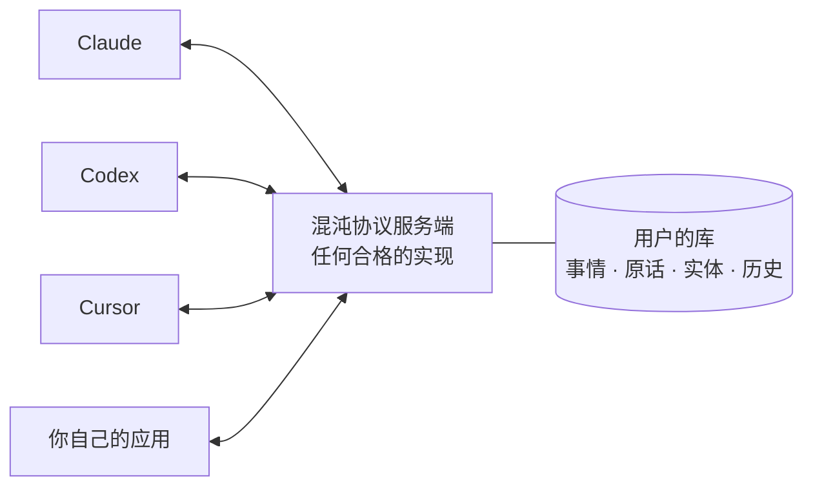

# 混沌协议 · Protocol Chaos

[](https://www.npmjs.com/package/protocol-chaos)
[](../PROTOCOL.md)
[](https://github.com/chaos-xxl/protocol-chaos/actions/workflows/test.yml)
[](../LICENSE)

[English](../README.md) · 简体中文

**一份开放协议：一个人生活里的那些事，由他自己掌握，他用的每个 AI 助手都能共用。**

人们跟 AI 助手说起旅行、装修、找工作、买东西、长远的愿望。每个助手听到的都只留给自己，所以同一个计划要跟每个新助手再讲一遍，换了工具就丢了。混沌协议把这些事放在一个属于用户的库里。任何兼容的助手都能读、能补充、能把里面的事连起来，换了助手，事情也还在。

有了混沌协议，助手可以：

- **接着上一个助手往下做**：读到用户几周前在另一台电脑上、跟另一个助手说过的事。
- **保留用户的原话**：原样记下来，自己的推断标明是推断。
- **把事连起来**：把一次旅行放到它服务的那个愿望下面，并指向它涉及的人。
- **和别的助手一起写**：不会覆盖别人已经写下的内容，每次改动都有记录。



## 快速开始

需要 Node.js 20 或更高版本，以及一个能用 MCP 服务端的助手。把参考服务端加到助手里，名字用 `protocol_chaos`：

- **Claude Code：**

  ```sh
  claude mcp add --scope user protocol_chaos -- npx -y protocol-chaos@0.2
  ```

- **Codex**，写在 `~/.codex/config.toml` 里：

  ```toml
  [mcp_servers.protocol_chaos]
  command = "npx"
  args = ["-y", "protocol-chaos@0.2"]
  ```

- **Claude Desktop、Cursor、Kiro** 等用 JSON 配置的客户端（`claude_desktop_config.json`、`~/.cursor/mcp.json`、`~/.kiro/settings/mcp.json`）：

  ```json
  { "mcpServers": { "protocol_chaos": { "command": "npx", "args": ["-y", "protocol-chaos@0.2"] } } }
  ```

然后跟一个助手说一件你在打算的事，比如「我想学街头摄影，不过只能周末去」。再问另一个助手，或者开一个新对话，问它我说过摄影什么。这件事存在 `~/.protocol-chaos/repository.json` 里，一个普通的文件，归你所有。

助手分布在几台电脑上，或者是云端助手：用 HTTP 运行同一个服务端，给每个助手单独一个令牌，见[远程接法](../server/README.md#remote)（英文）。

想效果好，请给每个助手装上[常驻指引](agent-guide.md#server-instructions)：MCP 只告诉助手有哪些工具，不告诉它什么时候用。`protocol-chaos@0.2` 跟着这一版草案和它的修复走，以后的草案会是 `0.3`。

## 为什么是混沌协议

- **事情由用户掌握。** 库属于用户，不属于某个助手或厂商；每个合格的服务端都能把它整个导出、导入到别处。
- **事情是连着的。** 看起来一次性的事，大多不是：一次旅行属于想多看看世界的愿望，一台相机服务于一个爱好。上下级关系、共同涉及的人和地方，把这些联系明确下来。
- **原话是证据。** 用户的原话原样保存，永不修改。助手得出的一切都以它为依据，以用户的话为准。
- **稀疏是常态。** 一件事可以只有一句话。助手记下用户说了什么，不追问用户把它补全。
- **小而可测。** 规范只定义各个实现必须一致的部分，对服务端的每一条要求都有兼容性测试。
- **建立在 MCP 之上。** 每项操作都是一个 MCP 工具，任何 MCP 客户端都能用合格的服务端，服务端用什么语言写都行。

## 协议定义了什么

| | |
|---|---|
| **事情（Event）** | 一件事：标题、状态、进展；用自然语言写的目标、约束、计划；涉及的人、地方和东西；以及它属于哪件更大的事。 |
| **原话（Account）** | 一件事所依据的用户原话，原样保存，永不修改。 |
| **实体（Entity）** | 用户提到的人、动物、东西和地方，包括用户本人，每条陈述只说一件事。 |
| **修订（Revision）** | 每一次改动，写明是谁改的、依据的是哪句原话。 |
| **写入规则** | 什么该记、什么不该记，让往同一个库里写的每个助手做法一致。 |
| **级别** | Core，以及可选的实体、搜索、同步、撤销、远程。 |

客户端怎么判断一段对话涉及哪些事、怎么排序、什么时候整理，由客户端自己决定。完整规则见 **[PROTOCOL.md](../PROTOCOL.md)**（英文）。

## 仓库里有什么

| 路径 | |
|---|---|
| [PROTOCOL.md](../PROTOCOL.md) | 规范，有约束力。 |
| [conformance/](../conformance/README.md) | 兼容性测试，通过 MCP 检查任何服务端。 |
| [server/](../server/README.md) | 参考服务端，从 Core 到远程全部级别都支持：一台电脑上用 stdio，几台电脑共用时用 HTTP。 |
| [docs/agent-guide.md](agent-guide.md) | 助手怎么用好一个库：先回答，后记录，晚点整理。不是规范。 |

## 实现这份协议

1. 读 [PROTOCOL.md](../PROTOCOL.md)，先做 Core 级别（§12）。
2. 把各项操作做成 MCP 工具（§9.1）：一台电脑用 stdio；几台电脑共用一个库时，用 streamable HTTP，每个客户端一个凭证（§9.2）。
3. 测你的服务端，不管它用什么语言写，也不用克隆仓库：

   ```sh
   npx -y -p protocol-chaos@0.2 protocol-chaos-conformance --stdio "node my-server.js --data {tmp}"
   ```

   套件每启动一个服务端，`{tmp}` 就换成一个新的空目录。测试会写数据，所以库不是空的就拒绝运行。

规范的目标是光看它就够写出实现。为了验证这一点，我们让一个从没见过任何实现的 Agent 只读这份文档写一个服务端。它第一次运行就通过了当时 40 项 Core 测试中的 39 项，它发现的那处缺口已经补进文档。这个服务端后来就成了这里的参考服务端。

## 你的数据

- 库属于它的用户，随时可以导出、搬到另一个服务端（§8.6）。
- 参考服务端把库存在它所在电脑上的一个文件里，不发往任何地方。用 HTTP 运行时，它只应答持有你发的令牌的助手。
- 目前每个接入的助手都能读到整个库，按客户端分别授权还没设计（§13）。只接入你愿意把全部内容交给它的助手。助手读到的内容会进入它的模型上下文，由它的服务商处理。
- 助手被要求永远不记录密码、令牌和证件号码（§7）。

## 现状与路线

混沌协议还是草案，草案不承诺兼容。draft 0.2 来自每天的使用：作者每天都在用 draft 0.1 的一个实现，几台电脑上的几个助手共用一个库；0.2 留下了使用中证明有用的部分。那个实现不在这个仓库里，正在改到 draft 0.2。

接下来：

- 给 [Hermes Agent](https://github.com/NousResearch/hermes-agent) 做一个插件：模型回答前先读，回答后再记。
- 按客户端分别授权：每个助手能读到什么（§13）。
- 跨应用认出同一个人（§13）。
- draft 0.3，从大家反馈的案例出发。

每个版本的变化见[更新记录](../CHANGELOG.md)。

## 常见问题

**这是一个记忆产品吗？** 不是，它是一份协议：约定一个人的事情怎么保存，让任何助手都能用。助手自带的记忆只留在那个助手里；混沌协议替这个人保存这些事，跨助手共用。

**需要服务端吗？** 需要，任何合格的都行。参考服务端在你电脑上用一条命令就能跑起来。你也可以自己写一个，兼容性测试会告诉你写对了没有。

**哪些助手能用？** 任何 MCP 客户端。快速开始里写了一台电脑上的 Claude Code、Codex、Claude Desktop、Cursor 和 Kiro。用 HTTP（远程级别）运行时，其他电脑上的助手、能连到你服务器的云端助手，也能共用同一个库。

**我的数据在哪？** 在你的服务端运行的地方，不在别处。见[你的数据](#你的数据)。

## 参与

协议最需要的是来自真实使用的证据：它适用的案例、它不够用的案例，以及各种实现。

- **问题和想法：** [Discussions](https://github.com/chaos-xxl/protocol-chaos/discussions)
- **修改规范：** 从一个真实案例出发，提一个[提案](https://github.com/chaos-xxl/protocol-chaos/issues/new?template=spec_proposal.yml)
- **bug：** [issues](https://github.com/chaos-xxl/protocol-chaos/issues)
- **安全问题：** 私下报告，见 [SECURITY.md](../SECURITY.md)

改动怎么决定，见 [CONTRIBUTING.md](../CONTRIBUTING.md)（英文）。

## 关于

混沌协议由薛星龙（[@chaos-xxl](https://github.com/chaos-xxl)）创建，是混沌系列的一员，另一个是 Doctor Chaos。采用 [Apache License 2.0](../LICENSE) 许可。
